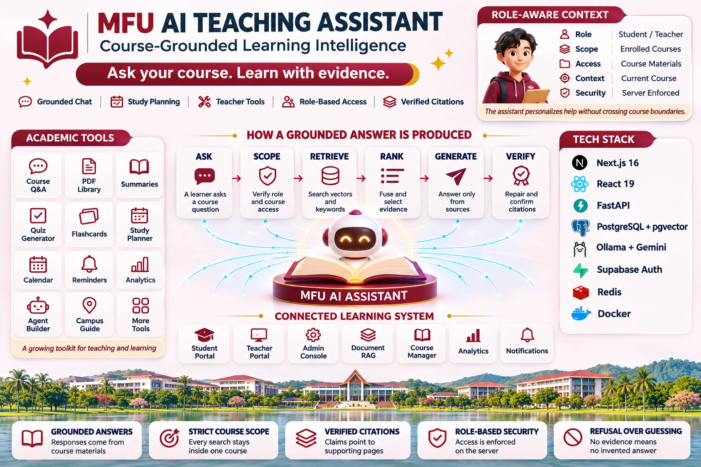
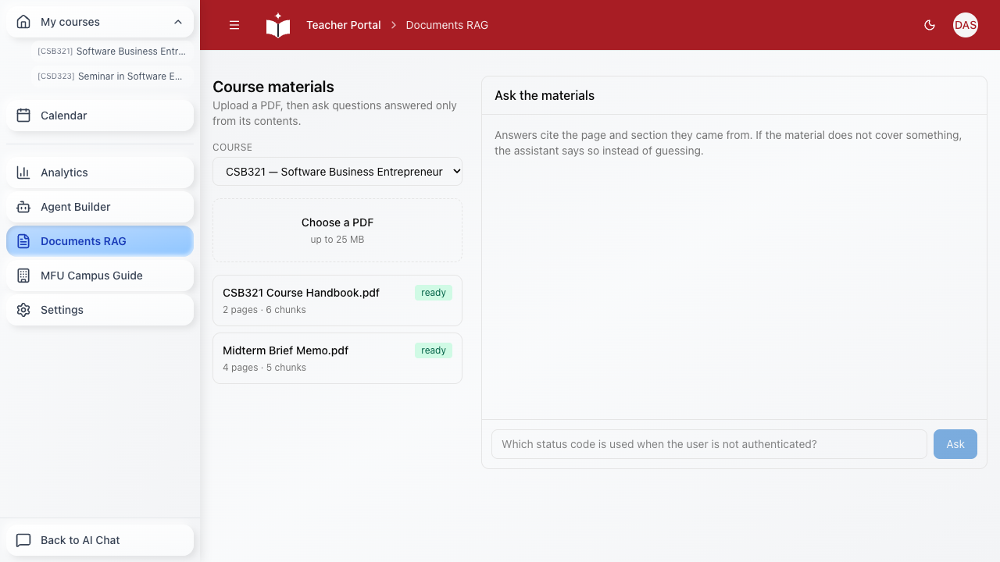
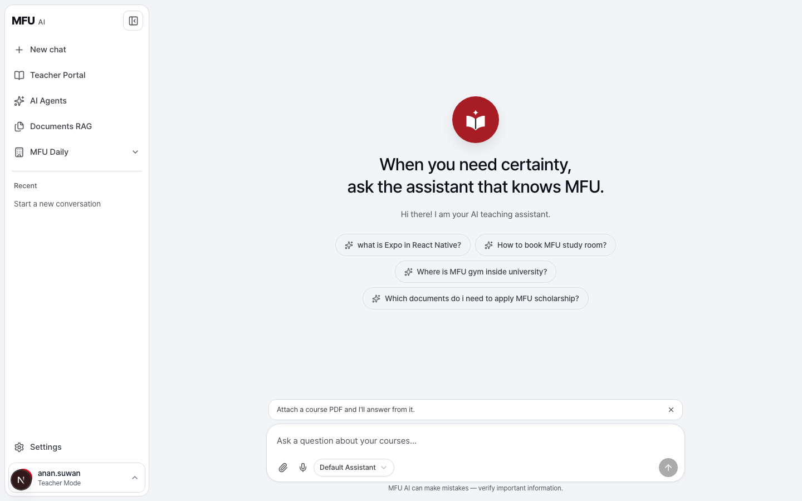
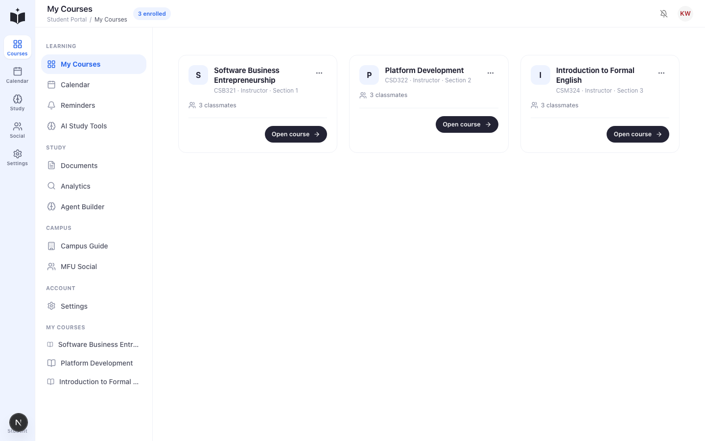
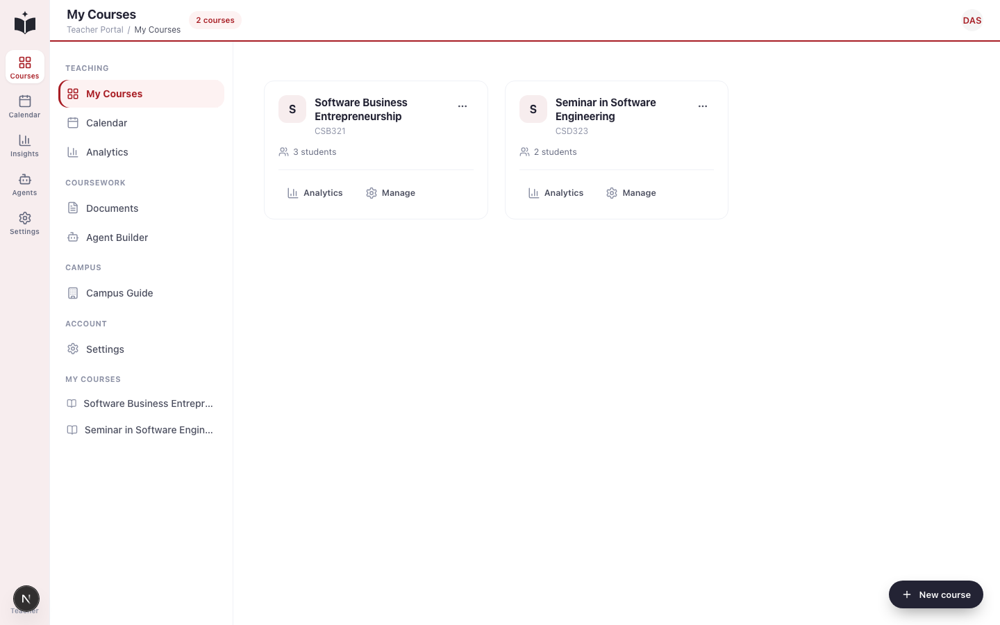
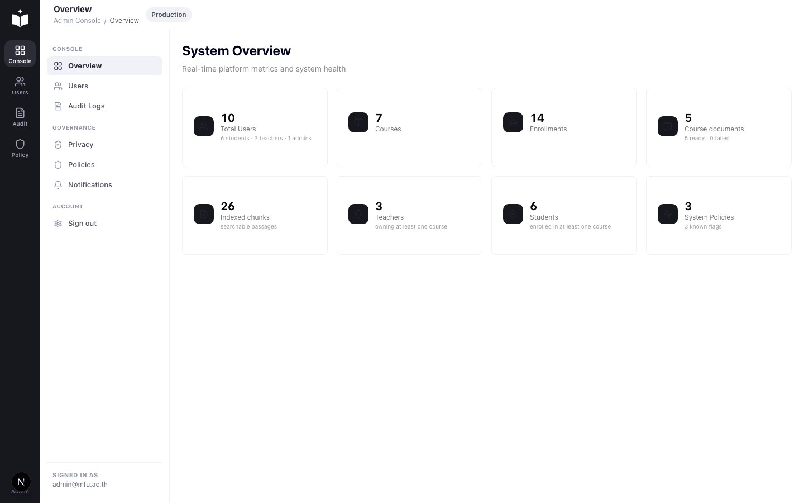
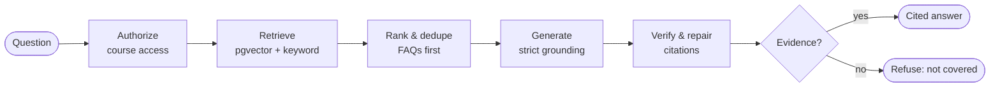
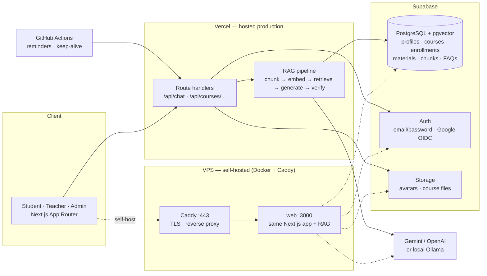
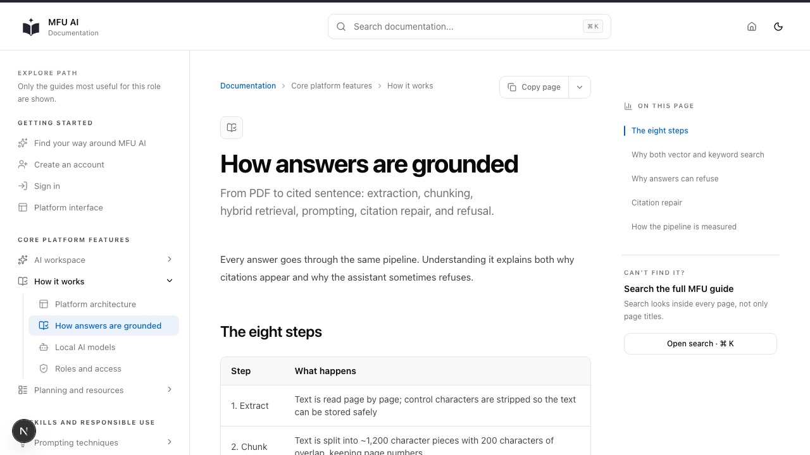

<div align="center">



# MFU AI Teaching Assistant

**Ask your course. Learn with evidence.**

A course-scoped RAG teaching assistant built for Mae Fah Luang University.
Teachers upload material into the courses they own, students ask questions about
the courses they are enrolled in, and every answer is either grounded in a cited
source or refused.

<p>
  <a href="https://github.com/zawwinhtutdev/mfu-ai-teaching-assistant/actions/workflows/ci.yml"></a>
  
  
  
  
  
</p>
<p>
  
  
  
  
</p>

<p>
  <a href="https://aiassistant-mfu.vercel.app">🔗 <b>Live demo</b></a> &nbsp;·&nbsp;
  <a href="docs/TEST_ACCOUNTS.md">🔑 <b>Demo accounts</b></a> &nbsp;·&nbsp;
  <a href="docs/DEPLOY.md">🚀 <b>Deploy</b></a> &nbsp;·&nbsp;
  <a href="https://aiassistant-mfu.vercel.app/docs">📖 <b>Docs</b></a> &nbsp;·&nbsp;
  <a href="https://github.com/zawwinhtutdev/mfu-ai-teaching-assistant/issues/new/choose">🐛 <b>Report a bug</b></a>
</p>

</div>

---

## Why this exists

Most "chat with your PDF" demos answer from one shared pile of documents. That
does not survive contact with a university:

- **Courses are isolation boundaries.** A student in CSD322 must never retrieve
  material from CSB321, even if they ask for it directly.
- **Answers need evidence.** A claim about a deadline or an API must point at the
  page it came from.
- **No evidence should mean no answer.** A model that has not read the material
  should say so instead of inventing something plausible.

Those properties are structural here, not prompt suggestions: access is checked
server-side on every request, retrieval is scoped to a single course, and
citations are verified and repaired after generation.

## 🖼️ Product tour

| Course-scoped document RAG | Grounded, cited chat |
| :---: | :---: |
|  |  |
| **Teacher:** upload a PDF into a course you teach, then ask questions answered only from its contents. | **Student:** answers stream with citations — or an explicit refusal when the material does not cover the question. |

| Student portal | Teacher portal | Admin console |
| :---: | :---: | :---: |
|  |  |  |
| **Students** see only enrolled courses, deadlines, reminders and study tools. | **Teachers** see only their courses, rosters, materials and analytics. | **Admins** manage people, courses, policies, privacy and audit logs. |

## 🚀 Features

| Role | What they can do |
| --- | --- |
| 👩‍🏫 **Teacher** | Manage only the courses they teach (incl. multi-teacher courses), upload PDFs and materials, post assignments and deadlines, review analytics on unanswered questions, tune the course assistant, manage announcements and FAQs. |
| 🎓 **Student** | Access only enrolled courses, read course materials, ask grounded questions with citations, track deadlines and reminders, use flashcard/quiz/study-planner tools, review chat history. |
| 🛠️ **Admin** | Platform overview, user and role management, course and enrollment management, system policies, privacy and consent controls, audit log, notification operations. |

On top of the portals:

- **Server-enforced RBAC.** Roles live in `public.profiles.role` and are enforced with Supabase Row Level Security plus a middleware route guard. Editing a URL does not bypass access control.
- **Course-scoped retrieval.** The course is authorized *before* retrieval runs; an unauthorized request is refused instead of falling through to a wider search.
- **Verified citations.** Every claim carries a source marker, and markers that point at the wrong passage are repaired after generation; changes are reported, never silent.
- **Refusal over guessing.** With no relevant evidence the assistant replies *"The course materials do not cover this."*, and the refusal is logged so teachers can see the gaps.
- **Google SSO.** Google OIDC through Supabase, with role derived from the MFU email domain (`@lamduan.mfu.ac.th` → student, `@mfu.ac.th` → teacher, admin allowlist) and rejection for any other domain.
- **Deadline reminders.** Publishing an assignment schedules one reminder per enrolled student. The daily scheduler is idempotent, so reruns cannot duplicate reminders.
- **Built-in documentation.** The app ships a searchable documentation site at [`/docs`](https://aiassistant-mfu.vercel.app/docs).
- **A real demo class.** Seeded design gives 3 teachers, 37 students and an admin, including the 36-student **Design Concept (1001143)** course — see [demo accounts](#-demo-accounts).

## 🧠 How an answer is grounded



1. **Authorize first.** The caller's role and enrollment are checked before retrieval, so an unauthorized course never reaches the vector index.
2. **Extract and index.** PDFs are parsed page by page; DOCX/PPTX text comes from the OOXML runs. Controls are stripped, then text is chunked (~1,400 chars with 220 overlap) and embedded into `vector(768)`.
3. **Retrieve.** Cosine similarity through `match_course_material_chunks`, fused with keyword search and scoped to one course. Teacher-authored FAQs rank ahead of material chunks.
4. **Build context.** Chunks are deduplicated, numbered `[1]…[n]`, and capped by a character budget that stops adding sources instead of truncating one.
5. **Generate.** A strict grounding prompt produces an answer only from the supplied passages; no sources means the refusal is emitted without spending a model call.
6. **Verify.** Streaming and citation checking pull in opposite directions, so the visible text streams first and the persisted text is corrected afterwards — markers another passage supports better are rewritten, duplicates collapse, and every change is reported.
7. **Refuse.** If nothing relevant is retrieved, the assistant refuses and records the gap for instructor analytics.

More detail: [How answers are grounded](https://aiassistant-mfu.vercel.app/docs/core/how-answers-are-grounded).

## 🏗️ Architecture



The browser never talks to the database directly and never decides what it may
read. **Both hosts run the same Next.js app** and point at the same Supabase
project: Vercel is the hosted production path, while the VPS
([`docker-compose.prod.yml`](docker-compose.prod.yml), with Caddy terminating
TLS) is the self-hosted alternative — one or the other serves a given origin,
not both in one request. Dashed edges mark the self-host path. GitHub Actions
call whichever origin `APP_BASE_URL` names. The reference FastAPI pipeline in
[`services/api`](services/api) is still used for evaluation, but it is **not**
on either request path.

### Tech stack

| Layer | Choice |
| --- | --- |
| **Web** | Next.js 16.4 (App Router, Turbopack), React 19, TypeScript 6, Tailwind CSS 4, Radix/shadcn UI |
| **Data** | Supabase PostgreSQL + pgvector; Row Level Security on every user-facing table |
| **Auth** | Supabase Auth — email/password plus Google OIDC; roles derived from the university email domain |
| **AI** | Vercel AI SDK 7 → OpenAI or Google Gemini; optional fully local Ollama (`qwen2.5:7b` + `nomic-embed-text`) |
| **Retrieval** | pgvector cosine similarity + keyword fusion, FAQ priority, citation repair |
| **Deploy** | Vercel + Supabase Cloud (production); Docker/Caddy self-host path; GitHub Actions scheduled jobs |
| **Quality** | `tsc --noEmit`, ESLint, GitHub Actions CI, 96 pytest tests for the reference pipeline, answer-accuracy evals |

## ⚡ Quick start

### Prerequisites

- **Node.js 22+**
- **Docker** and the **Supabase CLI** for the local database/auth stack
- Optional: **Ollama** for fully local models, or a Gemini/OpenAI API key for hosted models

### Run locally

```bash
git clone https://github.com/zawwinhtutdev/mfu-ai-teaching-assistant.git
cd mfu-ai-teaching-assistant
npm install

cp .env.example .env.local
supabase start
supabase db reset          # applies migrations + seed demo content

# Paste the API URL, anon key and service_role key from `supabase status` into .env.local
npm run dev
```

Open **http://localhost:3000** and sign in with any demo account below.

**AI provider** — set one of these in `.env.local`:

```bash
# Hosted (recommended for a quick start)
AI_PROVIDER=gemini
GOOGLE_GENERATIVE_AI_API_KEY=...

# or OpenAI
AI_PROVIDER=openai
OPENAI_API_KEY=...

# or local models (nothing leaves the machine)
AI_PROVIDER=ollama
ollama pull qwen2.5:7b
ollama pull nomic-embed-text
```

There is also a helper for starting/stopping the local stack:

```bash
./scripts/dev.sh start     # start | stop | restart | status
./scripts/dev.sh seed      # seed academic rows + demo course PDFs (idempotent)
```

### Deploy

The production setup is **Vercel** (web) + **Supabase Cloud** (database, auth, storage).
Step-by-step instructions — including Google OAuth configuration and URL
allow-lists — are in [docs/DEPLOY.md](docs/DEPLOY.md). Self-hosting (Docker/Caddy)
is covered in [docs/VPS_SETUP.md](docs/VPS_SETUP.md).

## 👥 Demo accounts

Every seeded account is a **real Supabase auth user** with the shared password
**`demo1234`**. Sign in at [aiassistant-mfu.vercel.app/login](https://aiassistant-mfu.vercel.app/login).

| Role | Accounts |
| --- | --- |
| 🛠️ **Admin** | `admin@mfu.ac.th` |
| 👩‍🏫 **Teachers** | `anan.suwan@mfu.ac.th` · `malee.chaiyaporn@mfu.ac.th` · `somchai.prasert@mfu.ac.th` |
| 🎓 **Students** | `6531503078@lamduan.mfu.ac.th` · `6531503085@lamduan.mfu.ac.th` · `6531503092@lamduan.mfu.ac.th` · `6531503101@lamduan.mfu.ac.th` · `6531503118@lamduan.mfu.ac.th` · `6531503125@lamduan.mfu.ac.th` · 30 more (`6531503126`–`6531503155`) |

The full list, roles and course enrollments live in
[docs/TEST_ACCOUNTS.md](docs/TEST_ACCOUNTS.md). The demo data includes a real
36-student course — **1001143 Design Concept** — taught by two teachers, so the
teacher, student and admin portals all have something realistic to show.

> These are public demo accounts for the demo deployment. Do not store personal
> or sensitive data in the demo environment.

## 🧪 Tests, evaluation & CI

Every push and pull request runs the [CI workflow](.github/workflows/ci.yml):
TypeScript type-check, ESLint, a production build, the FastAPI test suite, and a
Docker smoke test.

```bash
npm run type-check         # tsc --noEmit
npm run lint               # ESLint
npm run test:roadmap       # structural smoke checks
npm run eval:answers       # answer-accuracy evaluation against the live pipeline

cd services/api && .venv/bin/python -m pytest -q   # 96 tests
```

Latest reference-pipeline evaluation on a laptop with local `qwen2.5:7b`:

| Metric | Result |
| --- | --- |
| Answer accuracy | 100% (5/5 answered, target ≥ 85%) |
| Refusal accuracy | 100% (3/3 unanswerable refused) |
| Citation validity | 100% (5/5 answered) |
| Latency | p50 ≈ 0.7 s · p95 ≈ 2.1 s |

These are small, course-specific regression checks — not a claim about general
model quality. Recall, refusal and citation validity were the metrics that caught
real bugs, so they are reported separately rather than hidden in one score.

## 📚 Documentation

The app ships its own searchable documentation at
[**aiassistant-mfu.vercel.app/docs**](https://aiassistant-mfu.vercel.app/docs)
(sources in [`content/docs`](content/docs)).



| Document | What it covers |
| --- | --- |
| [docs/DEPLOY.md](docs/DEPLOY.md) | Vercel + Supabase deployment, environment variables, Google SSO, verification |
| [docs/TEST_ACCOUNTS.md](docs/TEST_ACCOUNTS.md) | Every demo account, course enrollments, password reset |
| [docs/design-portals.md](docs/design-portals.md) | Portal information architecture and UX decisions |
| [docs/chat-shell.md](docs/chat-shell.md) | Chat shell layout, streaming and conversation model |
| [docs/VPS_SETUP.md](docs/VPS_SETUP.md) | Self-hosted Docker/Caddy notes |
| [docs/README.md](docs/README.md) | Documentation index |
| [content/docs](content/docs) | In-app docs source: architecture, grounding, roles, study tools, campus guide |

<details>
<summary><b>Repository layout</b></summary>

```text
app/                 Next.js routes — portals, chat, docs, API handlers
components/          UI: chat shell, portals, document RAG, docs, admin
content/docs/        In-app documentation source (Markdown)
lib/                 Auth, session, AI providers, retrieval, RAG helpers
supabase/            Migrations, seed data, local Supabase config
services/api/        FastAPI reference pipeline + evaluation harness (96 tests)
scripts/             dev.sh, smoke checks, preflight, reindex, latency baseline
docs/                Project docs, deployment runbooks, screenshots
```

</details>

## 🗺️ Roadmap

- [x] Persist questions and answers with feedback
- [x] Instructor analytics on unanswered questions
- [x] Deadline-driven assignment reminders
- [x] Consent capture and a published privacy notice
- [x] Multi-teacher courses with co-teacher visibility
- [x] Google SSO with server-derived roles
- [ ] Clickable citations that open the source page
- [ ] OCR fallback for scanned material and image-only slides
- [ ] LMS (Moodle/Canvas) roster and assignment sync
- [ ] Per-course unique constraints on document titles

## ⚠️ Known limitations

- **Citations are text, not links.** They carry filename and section but do not open the PDF at that page yet.
- **No OCR.** Scanned PDFs produce no extractable text; text inside images in DOCX/PPTX is not seen.
- **Email/LINE delivery needs credentials.** Without `RESEND_API_KEY` or `LINE_CHANNEL_ACCESS_TOKEN`, queued notifications fail loudly rather than pretending to send.
- **Single-node ingestion.** Designed for a course, not a whole faculty.
- **No LMS sync or SAML.** `/api/lms` is a stub; SSO is Google OIDC only.
- **Demo auth is intentionally insecure** where enabled and must stay behind `ALLOW_INSECURE_DEV_AUTH`.

## 🤝 Contributing

Contributions, issues and feature requests are welcome. Please read
[CONTRIBUTING.md](CONTRIBUTING.md) and our
[Code of Conduct](CODE_OF_CONDUCT.md) first. For security issues, see
[SECURITY.md](SECURITY.md) and report privately.

- 🐛 [Report a bug](https://github.com/zawwinhtutdev/mfu-ai-teaching-assistant/issues/new?template=bug_report.yml)
- 💡 [Request a feature](https://github.com/zawwinhtutdev/mfu-ai-teaching-assistant/issues/new?template=feature_request.yml)
- 🔧 [Open a pull request](https://github.com/zawwinhtutdev/mfu-ai-teaching-assistant/compare)

## 🔐 Security

Please do **not** open a public issue for a vulnerability. Use GitHub's
[private vulnerability reporting](https://github.com/zawwinhtutdev/mfu-ai-teaching-assistant/security/advisories/new)
or the contact in [SECURITY.md](SECURITY.md).

## 🙏 Acknowledgements

Built at **Mae Fah Luang University** as a course-scoped AI teaching assistant
project. Thanks to the open-source teams behind Next.js, React, Supabase,
Vercel AI SDK, shadcn/ui, Radix UI, Tailwind CSS and the FastAPI reference
pipeline, and to everyone who tested the portals with real course material.

## 📄 License

[MIT](LICENSE) © 2026 Zaw Win Htut

---

<div align="center">
  <sub>If this project helped you, consider giving it a ⭐ — it helps others find it.</sub>
</div>
